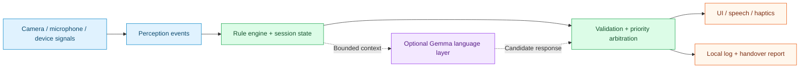

# FirstAid Copilot

**An offline-first companion for adult CPR guidance and scenario-based practice.**

**English** · [简体中文](README.zh-CN.md)


[Quick start](#quick-start) · [Feature status](#feature-status) · [Architecture](#architecture) · [Practice branch](https://github.com/17-chen/first-aid-co-pilot/tree/codex/practice-copilot-training) · [Technical reference (中文)](docs/technical-guide.zh-CN.md)

FirstAid Copilot combines a deterministic guideline state machine with speech, camera-based movement signals, and constrained on-device AI. It explores how to guide a person through the adult CPR workflow, provide timely feedback, and prepare a structured handover report.

**The rule engine owns medical progression. Gemma assists with language and interaction.** Critical CPR feedback does not wait for an LLM response.

> [!IMPORTANT]
> This is a development prototype, not a clinically validated medical device or a replacement for emergency professionals. In an emergency, contact local emergency services. The demo simulates a call to China's 120 emergency number; it does not automatically place a real call. The current emergency scope is adult suspected cardiac arrest.

## Feature status

**This page describes `main`. Practice Copilot is available in a separate branch.**

| Component | Where to find it | Current scope |
| --- | --- | --- |
| Emergency Copilot | [`android/`](android/), [`src/`](src/) on `main` | Adult CPR workflow, speech/UI/haptic delivery, vision feedback, and handover; model assets require provisioning |
| Android Practice | [Training source](https://github.com/17-chen/first-aid-co-pilot/tree/codex/practice-copilot-training/android/app/src/main/java/com/firstaid/copilot/training) | Separate **FirstAid Practice** launcher; five-step adult-collapse touch scenario |
| Practice Web prototype | [Prototype source](https://github.com/17-chen/first-aid-co-pilot/tree/codex/practice-copilot-training/prototypes/practice-copilot) | Adult collapse, choking, and severe bleeding; guided practice, scenario challenge, and review |
| Practice voice/camera input | Practice branch | Simulated in the Web prototype; real multimodal training adapters remain future work |
| iOS client | Not included in this repository | No public iOS source in this checkout |

Choking and bleeding are **practice prototype content**, not additional supported emergency workflows. These scenarios require professional content review before production use.

## Practice preview

Reference screens from the **Practice Web prototype**, currently with a Chinese interface. These are not screenshots of the Emergency Android client. Voice and camera observations in the prototype are simulated.

<table>
  <tr><th>Start a scenario</th><th>Make a decision</th><th>Review the sequence</th></tr>
  <tr>
    <td></td>
    <td></td>
    <td></td>
  </tr>
</table>

## What the project explores

- **Local operation:** native Android rule logic and provisioned speech/model assets support an offline path. The Node reference provides mock and real-model development paths.
- **Responsive guidance:** deterministic feedback, timing, and priority handling keep critical actions independent of model latency.
- **Observable movement:** MediaPipe Pose supplies rate, interruption, arm-posture, and hand-position proxies. Monocular video does not establish clinical compression depth.
- **Coordinated output:** the screen, speech, haptics, and controlled tool actions deliver guidance together.
- **Structured handover:** local session facts feed a handover report instead of unconstrained model-generated medical conclusions.

## Architecture

This diagram summarizes responsibility boundaries. The Node reference and native Android implementation have different internal wiring; see the technical reference for details.



The main contracts are `PerceptionEvent` (observations), `SessionState` (workflow facts), and `GuidanceAction` (validated delivery). The model cannot freely set medical stages or execute tools.

## Quick start

### 1. Run the reference demo without downloading models

Requires **Node.js 20+** and Git. The core uses Node's built-in test runner and has no runtime npm dependencies.

```bash
git clone https://github.com/17-chen/first-aid-co-pilot.git
cd first-aid-co-pilot
npm run demo
npm test
```

Inspect channel dispatch or launch the browser development surface:

```bash
npm run demo:dispatcher
npm run voice:serve
```

Open `http://127.0.0.1:8787/`. Default mock behavior tests the workflow, not real speech recognition or on-device inference. Emergency prompts and reference content are primarily Chinese.

### 2. Try the Practice prototype

From a fresh clone, switch to the existing feature branch and serve it with Python 3:

```bash
git switch codex/practice-copilot-training
python3 -m http.server 4173 --bind 127.0.0.1 --directory prototypes/practice-copilot
```

Open `http://127.0.0.1:4173/`. No model, microphone/camera permission, or backend is needed for this simulated prototype.

**Guided practice** provides teaching and immediate feedback. **Scenario challenge** hides immediate correctness and collects decisions for final review. Both modes use the same scenario data.

### 3. Build Android

On `main`, configure **JDK 17**, **Android SDK API 35**, and compatible system **Gradle 8.9** (the existing Windows guide uses 8.13):

```bash
gradle -p android testDebugUnitTest assembleDebug
```

The Practice branch additionally includes a pinned Gradle wrapper. Its independent launcher does not initialize an Emergency session.

The APK output is `android/app/build/outputs/apk/debug/app-debug.apk`. A source build is not automatically the model-bundled offline package. See [Android setup](android/README.md) and the [technical reference](docs/technical-guide.zh-CN.md) for assets, feature flags, Windows setup, and device validation.

### 4. Explore real speech and Gemma

Copy `.env.example` to a private `.env`, provision model/speech assets, and follow the technical reference. Supplied setup scripts use PowerShell; model downloads may require accepting provider terms.

```bash
npm run setup:gemma
npm run setup:speech
npm run verify:local:strict
```

Strict verification requires real resources. A passing mock demo does not establish model, speech, or device readiness. Some Android AI features are opt-in flags; source availability does not mean every model feature is enabled by default.

An [upstream model-bundled Android package](https://github.com/Remaker-A/first-aid-co-pilot/releases/tag/v0.1.0-offline-apk) is documented in the [installation reference](docs/technical-guide.zh-CN.md#离线-apk-安装包测试用户看这里). That existing release does **not** include the separate Practice branch. Follow the reference's split-file assembly and storage requirements.

## Repository map

| Path | Purpose |
| --- | --- |
| [`src/`](src/) | Node reference: rules, validation, Gemma, speech, reporting, and development server |
| [`android/`](android/) | Primary Android app and local execution path |
| [`android_nav/cpr_new/`](android_nav/cpr_new/) | Additional native Android integration module |
| [`knowledge/`](knowledge/) · [`prompts/`](prompts/) | Explicit rule data, controlled intents, safety language, and prompts |
| [`test/`](test/) | Reference-core regression tests |
| [`docs/`](docs/) | Design, interfaces, setup, and verification records |
| `prototypes/practice-copilot/` | Practice prototype; **feature branch only** |

## Documentation and contributions

- [中文首页](README.zh-CN.md)
- [Detailed technical reference (中文)](docs/technical-guide.zh-CN.md) — preserved from the previous README, including configuration, protocols, and installation details.
- [Android bring-up (English)](android/README.md)
- [Agent core reference (中文)](docs/Agent_Core_README.md)
- [Protocol interfaces (中文)](docs/Agent_Input_Output.md)
- [Documentation changes](docs/README_CHANGELOG.md)

For bug reports, include the branch, device/runtime, reproduction steps, and whether inputs were real or simulated. Remove credentials, recordings, and personal information from shared logs. Keep changes to medical rules explicit and reviewable.

## License

Code is available under [Apache License 2.0](LICENSE). Downloaded models and third-party assets have their own terms; see [third-party notices](THIRD_PARTY_NOTICE.txt).
