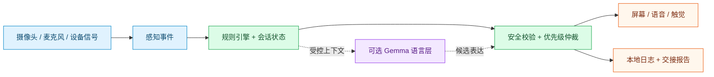

# FirstAid Copilot

**面向成人 CPR 现场指导与情境练习的端侧急救 Copilot。**

[English](README.md) · **简体中文**


[快速开始](#快速开始) · [功能状态](#功能状态) · [系统架构](#系统架构) · [练习分支](https://github.com/17-chen/first-aid-co-pilot/tree/codex/practice-copilot-training) · [详细技术参考](docs/technical-guide.zh-CN.md)

FirstAid Copilot 将确定性规则状态机、语音、摄像头动作信号与受约束的端侧 AI 结合，用于成人 CPR 流程引导、及时反馈和结构化交接报告。

**规则引擎负责医疗流程，Gemma 增强语言与交互。** CPR 关键纠错不等待大模型返回。

> [!IMPORTANT]
> 本项目是开发原型，尚非经过临床验证的医疗设备，也不能替代急救专业人员。真实紧急情况应联系当地急救服务。Demo 仅模拟拨打中国急救号码 120，不自动真实拨号。当前急救范围限于成人疑似心脏骤停。

## 功能状态

**本页对应 `main`。Practice Copilot 练习功能位于独立分支。**

| 模块 | 位置 | 当前范围 |
| --- | --- | --- |
| Emergency Copilot | `main` 的 [`android/`](android/) 和 [`src/`](src/) | 成人 CPR 流程、语音/UI/触觉、视觉反馈和交接；需要另外部署模型 |
| Android 练习 | [训练源码](https://github.com/17-chen/first-aid-co-pilot/tree/codex/practice-copilot-training/android/app/src/main/java/com/firstaid/copilot/training) | 独立 **FirstAid Practice** 图标，成人倒地五步触控演练 |
| Web 练习原型 | [原型源码](https://github.com/17-chen/first-aid-co-pilot/tree/codex/practice-copilot-training/prototypes/practice-copilot) | 成人倒地、气道梗阻、严重出血；引导练习、情境挑战、复盘 |
| 练习语音/摄像头 | 练习分支 | Web 中为模拟交互，真实多模态训练适配尚待接入 |
| iOS 客户端 | 本仓库未包含 | 当前检出内容没有公开 iOS 源码 |

气道梗阻和严重出血属于**练习原型内容**，不是已经支持的 Emergency 急救流程，生产使用前仍需专业内容审核。

## 练习原型预览

以下为 **Practice Web 原型的参考画面**，当前为中文界面，不是 Emergency Android 客户端截图；语音与摄像头观察均为模拟。

<table>
  <tr><th>进入情境</th><th>作出判断</th><th>完成复盘</th></tr>
  <tr>
    <td></td>
    <td></td>
    <td></td>
  </tr>
</table>

## 核心设计

- **本地运行：**Android 本地规则与已部署的语音/模型资源支持离线路径；Node 参考实现提供 mock 和真实模型开发路径。
- **及时反馈：**关键流程、纠错和优先级由确定性逻辑控制，避免模型延迟阻塞关键动作。
- **动作可观察：**MediaPipe Pose 提供频率、中断、手臂姿势和手位近似信号；单目视频不能确认临床按压深度。
- **多通道协同：**屏幕、语音、触觉和受控工具共同执行指导。
- **结构化交接：**报告基于本地会话事实，不由模型自由编造医疗结论。

## 系统架构

下图概括职责边界。Node 参考实现与 Android 原生实现的内部连接不同，细节见技术参考。



主要协议是 `PerceptionEvent`（观察）、`SessionState`（流程事实）与 `GuidanceAction`（校验后输出）。模型不能任意设置医疗阶段或执行工具。

## 快速开始

### 1. 不下载模型，先跑参考 Demo

需要 **Node.js 20+** 与 Git。参考核心没有运行时 npm 依赖，测试使用 Node 内置测试框架。

```bash
git clone https://github.com/17-chen/first-aid-co-pilot.git
cd first-aid-co-pilot
npm run demo
npm test
```

查看多通道分发或启动浏览器开发界面：

```bash
npm run demo:dispatcher
npm run voice:serve
```

打开 `http://127.0.0.1:8787/`。默认 mock 验证流程，不能代替真实语音和端侧推理验收；急救提示和参考内容目前以中文为主。

### 2. 体验练习原型

在全新克隆中切换现有分支，使用 Python 3 提供静态页面：

```bash
git switch codex/practice-copilot-training
python3 -m http.server 4173 --bind 127.0.0.1 --directory prototypes/practice-copilot
```

打开 `http://127.0.0.1:4173/`。模拟原型无需模型、麦克风/摄像头权限或后端。

**引导练习**包含教学与即时反馈；**情境挑战**暂不披露对错，结束后集中复盘。两种模式共享场景数据。

### 3. 构建 Android

`main` 需要 **JDK 17、Android SDK API 35、兼容的系统 Gradle（8.9，现有 Windows 指南使用 8.13）**：

```bash
gradle -p android testDebugUnitTest assembleDebug
```

练习分支另外提供固定版本的 Gradle wrapper，其独立入口不会初始化 Emergency 会话。

产物在 `android/app/build/outputs/apk/debug/app-debug.apk`。源码构建不等同于已内置模型的离线大包。模型、功能开关、Windows 环境和真机验收见 [Android 指南](android/README.md) 与 [详细技术参考](docs/technical-guide.zh-CN.md)。

### 4. 启用真实语音与 Gemma

复制 `.env.example` 为私有 `.env`，按技术参考部署模型与语音资源。安装脚本使用 PowerShell，模型下载可能需先接受提供方条款。

```bash
npm run setup:gemma
npm run setup:speech
npm run verify:local:strict
```

严格验证要求真实资源；mock 通过不等于模型、语音或设备就绪。Android 部分 AI 功能需要显式开启，源码存在不等于全部默认启用。

[上游离线 Android 安装包](https://github.com/Remaker-A/first-aid-co-pilot/releases/tag/v0.1.0-offline-apk) 的下载、分片合并和空间要求见 [安装参考](docs/technical-guide.zh-CN.md#离线-apk-安装包测试用户看这里)。既有发布包**不包含**本仓库的独立练习分支。

## 仓库结构

| 路径 | 用途 |
| --- | --- |
| [`src/`](src/) | Node 核心：规则、校验、Gemma、语音、报告、开发服务器 |
| [`android/`](android/) | 主 Android 应用与本地执行路径 |
| [`android_nav/cpr_new/`](android_nav/cpr_new/) | 另一套原生 Android 集成模块 |
| [`knowledge/`](knowledge/) · [`prompts/`](prompts/) | 规则数据、受控意图、安全话术和提示词 |
| [`test/`](test/) | 参考核心回归测试 |
| [`docs/`](docs/) | 设计、协议、环境和验证记录 |
| `prototypes/practice-copilot/` | **仅练习分支**包含的 Web 原型 |

## 文档与参与

- [English overview](README.md)
- [详细技术参考](docs/technical-guide.zh-CN.md)：保留原 README 的配置、协议和安装说明。
- [Android 环境指南（英文）](android/README.md)
- [Agent 核心说明](docs/Agent_Core_README.md)
- [输入输出协议](docs/Agent_Input_Output.md)
- [本次文档更新记录](docs/README_CHANGELOG.md)

反馈问题请说明分支、设备/运行环境、复现步骤，以及输入是真实还是模拟；分享日志前移除凭证、录音和个人信息。涉及医疗规则的变更应明确、可审查。

## 许可证

仓库代码使用 [Apache License 2.0](LICENSE)。模型与第三方资产另有条款，见 [第三方说明](THIRD_PARTY_NOTICE.txt)。
